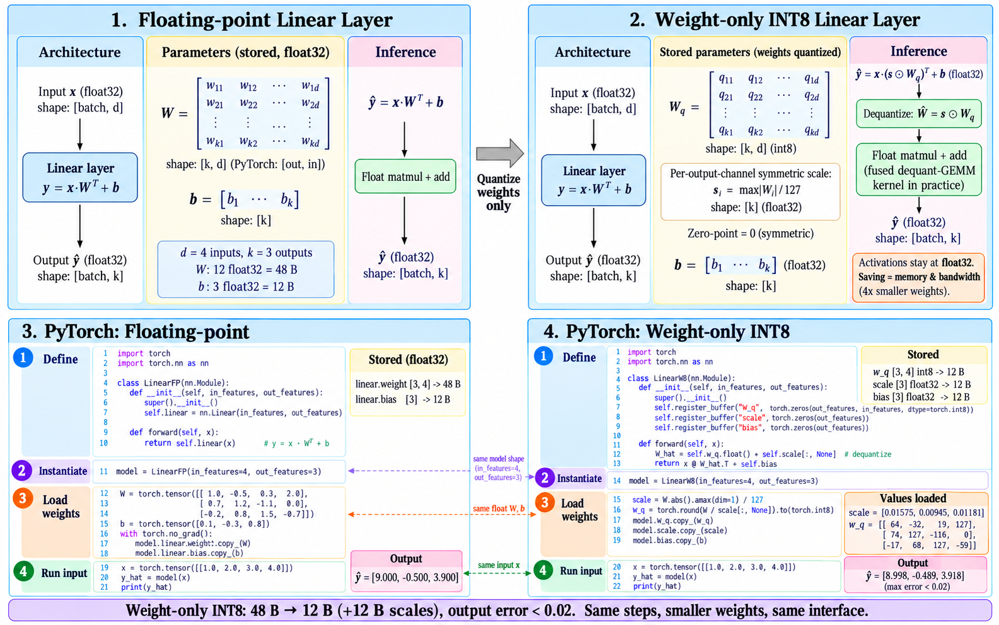
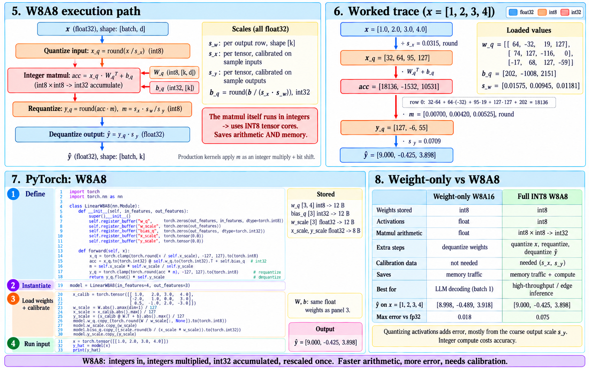

# Quantization schemes and targets

> **Module thesis:** [Lecture 21/22](Lecture21_22.md) built the affine map $r = S(q - Z)$ and decided how many values share one $(S, Z)$. Two more decisions fix a quantizer: **where the grid sits** (symmetric or asymmetric) and **when its scale is computed** (static or dynamic). Then comes the decision that sets the speedup: **which tensors are quantized at all**. Weights only saves memory traffic; weights and activations saves arithmetic as well.

**Prerequisite:** [Affine quantization](Lecture21_22.md)

---

## 1. Types of quantization

Every quantizer answers two independent questions:

| Question | Options | Fixed by |
| --- | --- | --- |
| **Where does the grid sit?** | symmetric · asymmetric | the shape of the data |
| **When is $S$ computed?** | static · dynamic | whether the data is known before inference |

### 1.1 Symmetric vs asymmetric

**Asymmetric** is the full affine map of Lecture 21/22 §1: fit the grid to $[r_{min}, r_{max}]$ and let $Z$ land wherever Equation 2.7 puts it.

**Symmetric** pins $Z = 0$ and centres the grid on real zero:

$$
S = \frac{\max |r|}{q_{max}}, \qquad q = \operatorname{clip}\!\left(\operatorname{round}\!\left(\frac{r}{S}\right),\; -q_{max},\; q_{max}\right)
$$

- int8 symmetric uses $[-127, 127]$. **Dropping $-128$** makes the grid a mirror image, so $-r$ quantizes to exactly $-q$.
- Fixed point (Lecture 19/20) is symmetric, with $S$ forced to a power of two.

**Worked example: data in [−1.0, 3.0], int8.**

| | Asymmetric | Symmetric |
| --- | --- | --- |
| $S$ | $4.0 / 255 = 0.0157$ | $3.0 / 127 = 0.0236$ |
| $Z$ | $64$ | $0$ |
| Integers used | all 256 | $-42 \ldots 127$: **170 of 255** |
| Step size | 1× | **1.5× coarser** |

**Symmetric wastes the grid on the side the data never reaches.** Post-ReLU activations in $[0, 6]$ use only $0 \ldots 127$, so half the integers sit idle.

**Asymmetric pays at runtime.** Lecture 21/22 §4 showed that a nonzero $Z_w$ adds the term $Z_w \sum q_x$, an extra pass over every input.

| | Symmetric | Asymmetric |
| --- | --- | --- |
| **Grid use on skewed data** | wastes up to half | full |
| **Integer dot product** | core term only | extra terms per input (Lecture 21/22 §4) |
| **Typical target** | **weights**: roughly zero-centred | **activations** after ReLU / GELU |

!!! note "In practice"
    Most int8 GPU inference stacks quantize **both** weights and activations symmetrically: TensorRT supports only symmetric int8 [2]. The kernel stays a single multiply-accumulate loop. Asymmetric grids appear where the bit budget is tightest, such as 4-bit weight blocks.

### 1.2 Static vs dynamic

**The scale for weights is always computed offline**, because weights are known before inference. The choice applies to **activations**, which depend on the input.

| | Static | Dynamic |
| --- | --- | --- |
| **When $S_x$ is computed** | once, offline, on a calibration set | every forward pass, from the live tensor |
| **Calibration data** | required | none |
| **Runtime cost** | zero: $S_x$ is a constant | one reduction ($\max \lvert x \rvert$) over the activations before each matmul |
| **Out-of-range input** | **clipped** to the calibrated range | cannot happen: the range is measured |
| **Typical use** | CNNs, edge accelerators | transformers, PyTorch `quantize_dynamic` [3] |

**Calibration** runs a few hundred representative inputs through the float model and records each activation's range. Min/max is the simplest rule; percentile and entropy rules [1] clip rare outliers to buy a finer step for everything else.

**Transformers push towards dynamic.** Activation ranges vary sharply from token to token, so one calibrated range is either too wide for most tokens or too narrow for some. Computing $S_x$ **per token** at runtime tracks each row.

!!! warning "Same words, different meaning"
    [Lecture 9/10](Lecture9_10.md) used *static* and *dynamic* for **batching**: when requests are grouped. Here they refer to **scales**: when $S_x$ is computed. The two choices are independent.

---

## 2. Quantization targets: weights only, or weights and activations

A Linear layer stores **weights**, and receives **activations** at runtime. Quantizing only the first saves bytes; quantizing both changes the arithmetic.

### 2.1 Weight-only (W8A16)

- **Stored:** `w_q` in int8, plus one symmetric scale per output row (Lecture 21/22 §5).
- **Computed:** dequantize, then a **float** matmul. Production kernels fuse the dequantize into the GEMM, so float weights never reach memory.
- **Calibration:** none. Every scale comes from the weights themselves.

### 2.2 Weights and activations (W8A8)

- **Computed:** int8 × int8 → int32. This is Lecture 21/22 §4's core term, with every $Z = 0$.
- **Requantize:** panel 5's $m = s_x s_w / s_y$ is Lecture 21/22 §4's $M$, applied once per output.
- **Scales:** $s_x$ and $s_y$ here are **static** and per-tensor (§1.2), so the layer needs calibration data.

### 2.3 Which one pays

[Lecture 9/10 §4](Lecture9_10.md) placed **decode at ~2 FLOP/byte**, far below the ridge, and prefill well above it.

| Regime | Bottleneck | Weight-only | W8A8 |
| --- | --- | --- | --- |
| **Decode, batch 1** | memory bandwidth | **captures the win**: bytes per token drop 2–4× | same bytes saved; the faster arithmetic sits idle |
| **Prefill, large batch** | compute | float matmul: no faster | **int8 tensor cores**: faster arithmetic |

**Weight-only attacks the bytes; W8A8 attacks the FLOPs.** Pick the target that matches the bottleneck.

!!! question "Break the calibration"
    Panel 7 calibrates $s_x = 4.0/127$ on three sample inputs. Feed the layer $x = [2, 4, 6, 8]$.

    - What is $x_q$?
    - Which of §1.2's two schemes avoids the damage, and what does it cost per forward pass?

---

## References

1. Wu et al., [*Integer Quantization for Deep Learning Inference: Principles and Empirical Evaluation*](https://arxiv.org/abs/2004.09602) (NVIDIA, 2020) — symmetric vs asymmetric cost, static calibration with max, percentile and entropy rules
2. NVIDIA, [*TensorRT Developer Guide — Working with Quantized Types*](https://docs.nvidia.com/deeplearning/tensorrt/latest/inference-library/work-quantized-types.html) — symmetric-only int8
3. PyTorch, [*Quantization*](https://pytorch.org/docs/stable/quantization.html) — dynamic quantization of Linear layers: int8 weights, activation scales computed per batch at runtime
4. [Lecture 21/22](Lecture21_22.md) — the affine map, the four-term dot product, the requantize multiplier $M$, granularity
5. [Lecture 9/10](Lecture9_10.md) — prefill vs decode on the roofline
