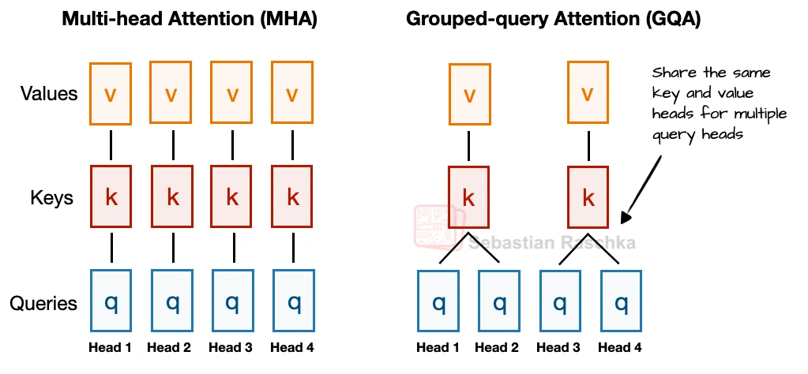
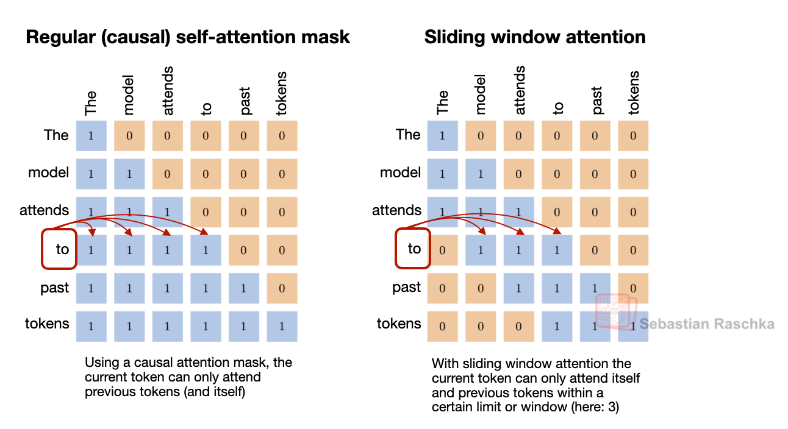
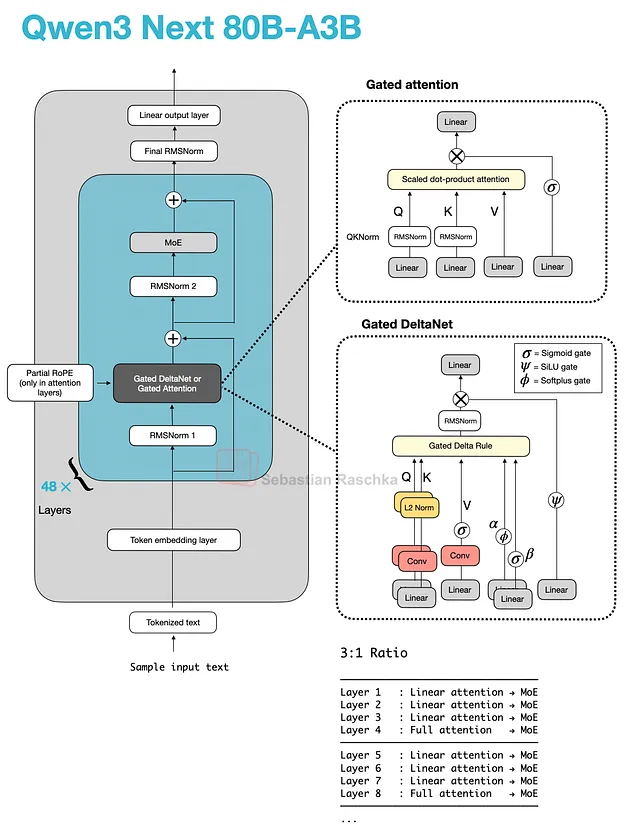
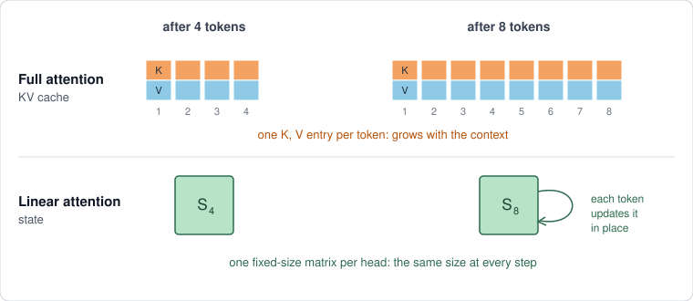
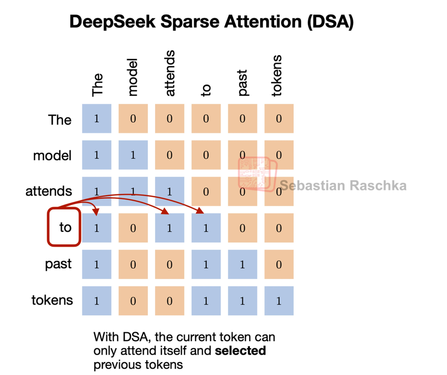

# Attention and the KV cache

> **Module thesis:** attention reads every past token's keys and values on every new token. Caching them trades quadratic recompute for memory that grows with the sequence, and that memory costs twice: in **capacity** (how many users fit) and in **traffic** (decode reads the whole cache per token). Two levers shrink it: **fewer KV heads**, fixed when the model is trained, and **fewer bits per element**, which the deployer chooses.

**Prerequisites:** [Prefill vs decode and the memory wall](Lecture9_10.md) · [Affine quantization](Lecture21_22.md) · [Quantization schemes and targets](Lecture23_24.md)

---

!!! abstract "Part 1 — Lecture 27: attention as a memory problem"
    What attention computes, why its cost is quadratic, why keys and values can be cached, and what that cache costs.

!!! question "Before we start"
    Qwen3-0.6B is 1.19 GB in BF16. How long can one conversation get before its KV cache outweighs the model?

## 1. Attention routes information by content

Every token arrives as a vector $x$ of width $d_{model}$. Three learned projections turn it into three roles:

| Vector | Role | Analogy |
| --- | --- | --- |
| **Query** $q = xW_Q$ | what this token is looking for | a search request |
| **Key** $k = xW_K$ | what this token offers to be found by | a folder's label |
| **Value** $v = xW_V$ | what this token hands over when matched | the folder's contents |

**Example:** *"The hungry dog ate the bone."*

- The query of **ate** asks, roughly, "what was eaten?"
- The key of **bone** matches that query well; the key of **hungry** matches it poorly.
- The new representation of **ate** is a **weighted blend of values**, dominated by bone's.

**The weights are computed from the data.** A convolution's weights are fixed after training; attention's mixing weights change with every sentence. This is **content-dependent routing**.

## 2. Scoring: dot product, scale, softmax

*Figure: Vivek Kalyanarangan, [Quantization and Fast Inference](https://www.manning.com/books/quantization-and-fast-inference), Manning Publications — Figure 3.7.*

**One query against every key, then a weighted sum of every value.** The equation below is this pipeline for all queries at once.

$$
\operatorname{Attention}(Q, K, V) = \operatorname{softmax}\!\left(\frac{QK^\top}{\sqrt{d_{head}}} + M\right) V
$$

- **Score** $s_{ij} = q_i \cdot k_j$: how well token $j$'s key answers token $i$'s query.
- **Scale by $\sqrt{d_{head}}$:** a dot product of $d$ unit-variance terms has variance $d$. Unscaled, large scores saturate the softmax and one token takes all the weight.
- **Softmax** over $j$ turns scores into weights that sum to 1.
- **Mask $M$:** in a decoder, $M_{ij} = -\infty$ for $j > i$, so no token attends to the future. This **causal mask** is what makes §5.1 work.
- **Output** $o_i = \sum_j a_{ij} v_j$.

## 3. Multi-head attention

One query per token must serve every relationship at once. In *"The exhausted dog ate the bone he buried yesterday"*, **he** needs **dog**, **ate** needs **bone**, and **buried** needs **yesterday**. One query averages them into a blur.

**Multi-head attention runs $h$ attentions in parallel**, each with its own projections:

- Each head projects the **full** $d_{model}$ vector down to $d_{head}$ through its own $W_Q^{(i)}, W_K^{(i)}, W_V^{(i)}$. **It is a learned projection, not a slice**: every head sees every input dimension and keeps what it needs.
- The $h$ outputs are **concatenated** into a vector of width $h \cdot d_{head}$.
- An **output projection** $W_O$ maps it back to $d_{model}$ and mixes what the heads found.
- With $h \cdot d_{head} = d_{model}$, the FLOPs equal one wide head. The heads buy specialisation at no extra arithmetic.

**Qwen3-0.6B shows it is a projection.** $d_{model} = 1024$, but $16 \times 128 = 2048$. A slice cannot produce more numbers than it started with; a projection can.

| Tensor | Shape, Qwen3-0.6B |
| --- | --- |
| input $X$ | $n \times 1024$ |
| $W_Q$, all heads | $1024 \times (16 \cdot 128)$ |
| $W_K$, $W_V$, all heads | $1024 \times (8 \cdot 128)$: fewer KV heads, see §5.4 |
| $W_O$ | $2048 \times 1024$ |

## 4. The cost is quadratic

Every query is compared with every key, **including its own**. Direction matters too: *ate → bone* and *bone → ate* are different scores.

| Sequence | Scores per head per layer |
| ---: | ---: |
| 6 tokens | $6^2 =$ 36 |
| 4,096 tokens | $4096^2 \approx$ **16.8 million** |
| 32,768 tokens | $\approx$ **1.07 billion** |

- **Qwen3-0.6B at 4,096 tokens:** 16 heads × 28 layers × 16.8M ≈ **7.5 billion scores** per forward pass.
- **Memory:** one head's $4096 \times 4096$ score matrix is **32 MiB** in FP16. At 32K tokens it is **2 GiB**.
- The causal mask uses only the lower triangle, $n(n+1)/2$ (21 of the 36). A straightforward kernel still computes the full square and masks it; [Lecture 29](Lecture29.md) §1 computes it without ever storing it.

!!! question "Double the context"
    Context goes from 4K to 8K tokens. By what factor do the scores grow? The weights?

## 5. The KV cache

Part 1 prices the cache; Part 2 shrinks it.

### 5.1 What is cached, and why it is exact

**Prefill** reads the whole prompt in one pass: the $n^2$ case, compute-bound. **Decode** then generates one token per pass ([Lecture 9/10](Lecture9_10.md) §3).

Generating token 101 needs:

- **its own query**, computed fresh;
- **the keys and values of tokens 1–100**, to score against and blend.

**Why store keys and values, but not queries?** A past token's query was used once, to compute that token's own output. Token 101's output uses only token 101's query. Old queries are never read again.

**Does a new token rewrite the keys and values of earlier ones? No.** The causal mask means token $j$'s hidden state, at every layer, depends only on tokens $\le j$. Its key and value are **fixed the moment they are computed**.

| Per decode step | Without a cache | With a cache |
| --- | --- | --- |
| K, V projections | all $t$ tokens, again | **1 new token** |
| Scores | $t$ | $t$ |
| Memory held | none | **every past K and V** |

**The trade:** recompute that grows with every step, exchanged for memory that grows with every token. §5.2 prices that memory.

!!! tip "Notebook — KV cache, measured · part 1"
    Generate with and without the cache on Qwen3-0.6B. The tokens come out identical; the per-token time without a cache grows with the context, and with one it stays flat.

    [**Open in Colab**](https://colab.research.google.com/github/Ankush-Chander/DS635-ml-system-engineering/blob/main/docs/notebooks/kv_cache_shapes.ipynb) · [view on GitHub](https://github.com/Ankush-Chander/DS635-ml-system-engineering/blob/main/docs/notebooks/kv_cache_shapes.ipynb)

### 5.2 Sizing the cache

$$
\text{KV bytes per token} = 2 \times n_{layers} \times n_{kv\_heads} \times d_{head} \times \text{bytes per element}
$$

The leading 2 counts $K$ and $V$. Every term comes from the model's `config.json`.

| Model | Layers | Q heads | KV heads | $d_{head}$ | Weights, BF16 | **KV / token** | KV at max context |
| --- | ---: | ---: | ---: | ---: | ---: | ---: | ---: |
| **Qwen3-0.6B** | 28 | 16 | 8 | 128 | 1.19 GB | **112 KiB** | 4.38 GiB at 40,960 |
| **Llama-2-7B** | 32 | 32 | 32 | 128 | 13.48 GB | **512 KiB** | 2.00 GiB at 4,096 |
| **Llama-3-8B** | 32 | 32 | 8 | 128 | 16.06 GB | **128 KiB** | 1.00 GiB at 8,192 |

- **Answer to the opener:** 1.19 GB ÷ 112 KiB ≈ **10.4K tokens**, well inside Qwen3-0.6B's 40K window.
- **Read every term from `config.json`**, $d_{head}$ included.
- Llama-2-7B's cache matches its weights at 25.7K tokens. Its window is 4,096, so that takes **about 6 users** at full context.

!!! tip "Notebook — KV cache, measured · part 2"
    Predict one layer's K shape and the total KV bytes for 256 tokens, then run it: the formula is checked against Qwen3-0.6B's real cache, byte for byte.

    [**Open in Colab**](https://colab.research.google.com/github/Ankush-Chander/DS635-ml-system-engineering/blob/main/docs/notebooks/kv_cache_shapes.ipynb) · [view on GitHub](https://github.com/Ankush-Chander/DS635-ml-system-engineering/blob/main/docs/notebooks/kv_cache_shapes.ipynb)

!!! tip "Notebook — KV cache, measured · part 3"
    A table of context lengths, up to Qwen3-0.6B's 40,960-token maximum. One sequence's cache overtakes the weights at about 10.4K tokens; a batch of 8 gets there at about 1.3K.

    [**Open in Colab**](https://colab.research.google.com/github/Ankush-Chander/DS635-ml-system-engineering/blob/main/docs/notebooks/kv_cache_shapes.ipynb) · [view on GitHub](https://github.com/Ankush-Chander/DS635-ml-system-engineering/blob/main/docs/notebooks/kv_cache_shapes.ipynb)

### 5.3 Two costs, not one

| Cost | What grows | Consequence |
| --- | --- | --- |
| **Capacity** | bytes resident per user | users that fit $=$ KV budget $\div$ (context $\times$ bytes per token) |
| **Traffic** | bytes read per decode step | each step reads weights **plus the whole cache**, so tok/s falls as context grows |

- Measured on a 27B model, BF16 KV: **56 tok/s at 32 prompt tokens, 23 tok/s at 101K**. Same weights, same GPU.
- Weights dominate a short prompt's traffic. At long context the cache does.

!!! tip "Notebook — KV cache, measured · part 4"
    Weights are shared; the cache is per sequence. A table of batch sizes at 2,048 and 8,192 tokens shows Qwen3-0.6B's cache overtaking its weights at batch ≈ 5, and at batch ≈ 1.3 for the longer context.

    [**Open in Colab**](https://colab.research.google.com/github/Ankush-Chander/DS635-ml-system-engineering/blob/main/docs/notebooks/kv_cache_shapes.ipynb) · [view on GitHub](https://github.com/Ankush-Chander/DS635-ml-system-engineering/blob/main/docs/notebooks/kv_cache_shapes.ipynb)

### 5.4 Lever 1 — store less per token

**Decode multiplies one query vector by the whole cache.** That matrix-vector product reads every cached byte from HBM to compute very little (§5.3), so the lever is how much is cached. Each attention variant below cuts one term of the cache formula:

$$
\text{KV bytes} = 2 \times L_{full} \times H_{kv} \times D_h \times T_{cached} \times \text{bytes per element}
$$

| Variant | Term it cuts | How | Example models |
| --- | --- | --- | --- |
| **GQA / MQA** | $H_{kv}$ | query heads share key and value heads | Llama 3, Qwen3, Gemma 3 |
| **MLA** | $2 \times H_{kv} \times D_h$ | one compressed latent per token, shared by all heads | DeepSeek V3, Kimi K2 |
| **Sliding window (SWA)** | $T_{cached}$ in local layers | local layers keep only the last $W$ tokens | Gemma 3, OLMo 3 |
| **Hybrid** | $L_{full}$ | most layers keep a fixed-size state | Qwen3-Next, Qwen3.5, Kimi Linear |

#### Grouped-query attention (GQA): fewer KV heads

**Several query heads share one key and value head.** The attention computation is unchanged; only the number of KV projections drops.

*Figure: Sebastian Raschka, [The Big LLM Architecture Comparison](https://magazine.sebastianraschka.com/p/the-big-llm-architecture-comparison).*

$$
\text{elements per token per layer} = 2 \times H_{kv} \times D_h
$$

| Scheme | KV heads $H_{kv}$ | Example | Elements per token per layer | Trade-off |
| --- | --- | --- | ---: | --- |
| **MHA** | $= H_q$ | Llama-2-7B: 32 KV heads | 8,192 | full capacity, largest cache |
| **GQA** | $1 < H_{kv} < H_q$ | Llama-3-8B: 8 KV heads for 32 query heads | 2,048 | **4× smaller**; recovers most of MHA's quality |
| **MQA** | $1$ | one KV head for 32 query heads | 256 | **32× smaller**; every query head reads the same K and V, and quality drops |

- **GQA is the common choice today.** Llama-3-8B caches **128 KiB per token**, a quarter of Llama-2-7B's. Its cache equals its weights only at 122.5K tokens, **about 15 users** at its 8K window.
- Qwen3-0.6B is GQA too: 8 KV heads serve 16 query heads.

| Pros | Cons |
| --- | --- |
| **Simple:** standard attention with fewer KV projections | **Quality:** in DeepSeek-V2's ablation (Table 8), a dense 7B GQA model scored below MHA on all four benchmarks |
| **Robust:** easy to train, with few extra hyperparameters to tune | **A floor:** MQA, the limit of sharing, scored lower still |

#### Multi-head Latent Attention (MLA): compress what is cached

*Figure: Sebastian Raschka, [The Big LLM Architecture Comparison](https://magazine.sebastianraschka.com/p/the-big-llm-architecture-comparison).*

DeepSeek-V2 and V3 cache a **compressed vector** in place of per-head keys and values:

- Per token per layer, the cache holds a latent $c_t$ of width $d_c = 512$, produced by $W_{dkv}$ (the figure's compressed key and value), and a small key $k^R_t$ of width $d_r = 64$ that carries the RoPE position: **576 elements**.
- Each head's keys and values are $W_{uk} c_t$ and $W_{uv} c_t$. Because $q^\top (W_{uk} c_t) = (W_{uk}^\top q)^\top c_t$, the up-projections fold into the query and output weights, so **attention runs directly on the cached latent** and per-head keys and values are never rebuilt.
- An MHA layer with 128 heads of width 128 caches $2 \times 128 \times 128 =$ 32,768 elements per token. MLA stores **1.8%** of that.
- **DeepSeek-V3 (671B parameters):** 61 layers × 576 × 2 bytes ≈ **69 KiB per token**. That is less than Llama-3-8B's 128 KiB, and **about 7× less than Llama-2-7B**.

| Pros | Cons |
| --- | --- |
| **Smallest cache:** in DeepSeek-V2's ablation (Table 9), 15.6K vs 110.6K elements per token in the small MoE, 34.6K vs 860.2K in the large | **Complex:** decoupled RoPE key and folded projections make the attention stack harder to implement |
| **Quality kept:** matches or beats MHA on most benchmarks in the same ablation | **Scale-dependent:** practitioners report GQA is easier to tune below roughly 100B parameters |

#### Sliding-window attention (SWA): cache only a recent window

**A local layer lets each token attend only to the last $W$ tokens.** Its cache stops growing at $W$ entries. Global layers, interleaved between the local ones, still see the full prefix, so information can travel the whole sequence.

*Figure: Sebastian Raschka, [A Visual Guide to Attention Variants in Modern LLMs](https://magazine.sebastianraschka.com/p/visual-attention-variants).*

- **Gemma 3** pairs five local layers with one global layer, at $W = 1{,}024$. At 131K tokens, five of every six layers cache 1,024 tokens: the cache is $\tfrac16 + \tfrac56 \cdot \tfrac{1024}{131072} \approx$ **17% of all-global, about 5.8× smaller**.
- **SWA and GQA combine.** SWA cuts how many tokens a local layer caches; GQA cuts how much each token costs. Gemma 3 uses both.

| Pros | Cons |
| --- | --- |
| **Simple:** a mask change, nothing new to learn | **Local layers are blind past $W$:** global layers must stay, at 5:1 (Gemma 3, Xiaomi) or 3:1 (OLMo 3, Arcee Trinity) |
| **Big long-context saving** for most layers | **Two knobs to tune:** the local-to-global ratio and $W$, from 128 (Xiaomi) to 1,024 (Gemma 3) |
| **Little quality cost:** Gemma 3's ablation found a smaller window and a more aggressive ratio barely moved perplexity | |

#### Hybrid layers: cache fewer layers

**A hybrid model mixes two layer types.** Most layers are linear attention; every fourth is full attention.

*Figure: Sebastian Raschka, [Beyond Standard LLMs](https://magazine.sebastianraschka.com/p/beyond-standard-llms). Qwen3-Next: three Gated DeltaNet layers, then one full-attention layer, repeated.*

- **Linear-attention layers behave like an RNN.** Each head keeps one fixed-size state matrix $S_t$ that folds in every token, $S_t = S_{t-1} + k_t v_t^\top$, with an LSTM-style gate that lets old content fade. It is the same size at token 10 and at token 100,000.
- **Full-attention layers are ordinary attention.** They keep every past key and value, so they can still recall any token exactly, which a fixed-size state cannot.
- **Only the full-attention layers grow with context**, so the formula counts them alone:

$$
\text{KV bytes per token} = 2 \times L_{full} \times H_{kv} \times D_h \times \text{bytes per element}
$$

**Example: Qwen3.8-27B on a 48 GB workstation GPU.** 64 layers, of which 16 are full attention; 4 KV heads; $D_h = 256$; FP8 KV cache (§5.9).

| Per sequence | Full-attention layers (16) | Linear-attention layers (48) |
| --- | --- | --- |
| **Grows with context?** | yes: $2 \times 16 \times 4 \times 256 \times 1$ B = **32 KiB per token** | no: **≈ 155 MiB**, fixed |
| at 2,048 tokens | 64 MiB | 155 MiB |
| at 131,072 tokens | **4 GiB** | 155 MiB |

- With all 64 layers as full attention, the cache would be 128 KiB per token: **16 GiB** at 131K tokens, 4× more.
- At short context the fixed state is most of each request's memory; at long context the KV cache is.

- **The full-attention layers are gated** in Qwen3-Next and Qwen3.5: standard attention plus an output gate, a zero-centred QK-norm and partial RoPE, which make the retained layers behave more predictably inside the hybrid stack.

| Pros | Cons |
| --- | --- |
| **Flatter memory:** a 3:1 hybrid's cache grows at a quarter of full attention's rate | **Weaker exact recall:** a fixed-size state is less precise at content-based retrieval, so full-attention layers stay |
| **Fixed cost per token** in the linear layers, at any context length | **Two caches, two limits:** per-token KV bounds context; per-sequence state bounds concurrency (Lecture 29) |

??? note "Beyond storage: DeepSeek Sparse Attention (DSA)"
    **DSA restricts each token to a selected subset of earlier tokens, like SWA, but the model learns which ones.** A lightning indexer scores every prior token against the new query, using MLA's compressed representations, and a selector keeps only the highest-scoring positions for attention.

    

    *Figure: Sebastian Raschka, [A Visual Guide to Attention Variants in Modern LLMs](https://magazine.sebastianraschka.com/p/visual-attention-variants).*

    | Pros | Cons |
    | --- | --- |
    | **Learned selection:** keeps distant tokens that matter, which a fixed window drops | **Cache is not smaller:** any past token may be selected, so every token's latent stays stored |
    | **Less attention work per step** at long context: fewer keys are read and scored | **Extra machinery:** the indexer is its own learned component that runs every step |

    Used in DeepSeek V3.2, together with MLA, and in GLM-5.

#### The catch

- Every scheme here is **fixed at training time**. For a model you are handed, the remaining knob is **bytes per element**.

---

!!! abstract "Part 2 — Lecture 28: quantizing the KV cache"
    Why the cache needs dynamic scales, why keys and values get different granularity, and when FP8 KV pays.

!!! question "Predict"
    Turn on FP8 KV for a 27B model. Is decode faster or slower at a 32-token prompt? At 101K tokens?

### 5.5 When quantizing it pays

| Prompt tokens | BF16 KV, tok/s | FP8 KV, tok/s | Change |
| ---: | ---: | ---: | ---: |
| 32 | 56.31 | 54.53 | **−3%** |
| 15,422 | 40.47 | 42.58 | +5% |
| 30,922 | 35.78 | 42.61 | +19% |
| 101,320 | 22.65 | 36.25 | **+60%** |

- Quantize and dequantize cost the same per token at any length. **The traffic saved grows with context.**
- In FP8 the curve flattens: the cache term shrinks until weight reads dominate again.

### 5.6 Neither weight nor activation

- The cache is **produced online**, like an activation, and **reread on every step**, like a weight.
- It does not exist before inference, so there is no offline calibration. **Scales are dynamic** ([Lecture 23/24](Lecture23_24.md) §1.2).

### 5.7 Keys and values differ

| Tensor | Side of the softmax | Structure | Granularity |
| --- | --- | --- | --- |
| **K** | before: decides **which** tokens match | a few **outlier channels**, the same ones on every token | **per-channel** |
| **V** | after: carries **what** flows forward | variation **between tokens** | **per-token** |

- Measured on TinyLlama-1.1B, per-channel keys beat per-token keys in **6 of 6** tests, by 1.3–3.6×. The gap widens with depth.
- This is [Lecture 21/22](Lecture21_22.md) §5's rule: match the scale's grouping to where the outliers live.
- Per-token scales for $V$ cost 2 bytes per token per head: **about 3%** on 64 bytes of INT4 data at $d_{head} = 128$.

### 5.8 The streaming catch

- A per-channel scale for $K$ is a maximum **over tokens**. During decode, those tokens arrive one at a time.
- Fix: quantize keys per channel **within groups of tokens**, and hold the newest tokens in FP16 until a group fills (KIVI).

### 5.9 FP8 KV in practice

- **E4M3** is the default: cache values are well scaled, so mantissa beats range.
- **It pays twice.** With the same 12.4 GiB pool at a 131K-token limit, concurrency rose from **1.31× to 2.36×**: one resident long session became two.
- **It is lossy.** It perturbs attention scores, so check quality at the **longest** context you serve.

### 5.10 Below 4 bits

- **TurboQuant:** a random rotation spreads outlier channels evenly, and a fixed codebook quantizes each coordinate. **No calibration**, so it suits a tensor that arrives one vector at a time.
- **Decision rule:** judge the flag against **your context distribution**. Leave it off for chat under ~2K tokens; turn it on for agents working at 15K+.

---

## References

1. Vivek Kalyanarangan, *Quantization and Fast Inference*, Manning Publications — §3.4 key/value asymmetry and scale overhead; §7.5 TurboQuant; §10.5.1 the KV formula and GQA
2. Ainslie et al., [*GQA: Training Generalized Multi-Query Transformer Models from Multi-Head Checkpoints*](https://arxiv.org/abs/2305.13245) (2023)
3. Liu et al., [*KIVI: A Tuning-Free Asymmetric 2bit Quantization for KV Cache*](https://arxiv.org/abs/2402.02750) (2024)
4. Hooper et al., [*KVQuant: Towards 10 Million Context Length LLM Inference with KV Cache Quantization*](https://arxiv.org/abs/2401.18079) (2024)
5. Model configs: [Qwen3-0.6B](https://huggingface.co/Qwen/Qwen3-0.6B/blob/main/config.json) · [Llama-2-7B](https://huggingface.co/NousResearch/Llama-2-7b-hf/blob/main/config.json) · [Llama-3-8B](https://huggingface.co/NousResearch/Meta-Llama-3-8B/blob/main/config.json)
6. [Lecture 9/10](Lecture9_10.md) — prefill vs decode on the roofline
7. [Lecture 23/24](Lecture23_24.md) — static vs dynamic scales
8. Shazeer, [*Fast Transformer Decoding: One Write-Head is All You Need*](https://arxiv.org/abs/1911.02150) (2019) — multi-query attention
9. DeepSeek-AI, [*DeepSeek-V2: A Strong, Economical, and Efficient Mixture-of-Experts Language Model*](https://arxiv.org/abs/2405.04434) (2024) — multi-head latent attention; [DeepSeek-V3 config](https://huggingface.co/deepseek-ai/DeepSeek-V3/blob/main/config.json)
10. Katharopoulos et al., [*Transformers are RNNs: Fast Autoregressive Transformers with Linear Attention*](https://arxiv.org/abs/2006.16236) (2020) — linear attention as a recurrent state
11. Yang et al., [*Gated Delta Networks: Improving Mamba2 with Delta Rule*](https://arxiv.org/abs/2412.06464) (2024) — the gated delta rule; [Qwen3.8-27B-FP8 config](https://huggingface.co/Qwen/Qwen3.8-27B-FP8/blob/main/config.json)
12. Sebastian Raschka, [*A Visual Guide to Attention Variants in Modern LLMs*](https://magazine.sebastianraschka.com/p/visual-attention-variants) (2026) — GQA, MLA, sliding-window, sparse and hybrid attention, with their trade-offs
13. Gemma Team, [*Gemma 3 Technical Report*](https://arxiv.org/abs/2503.19786) (2025) — 5:1 local-to-global sliding-window attention
14. Qiu et al., [*Gated Attention for Large Language Models: Non-linearity, Sparsity, and Attention-Sink-Free*](https://arxiv.org/abs/2505.06708) (2025) — the gated full-attention layers in Qwen3-Next and Qwen3.5
