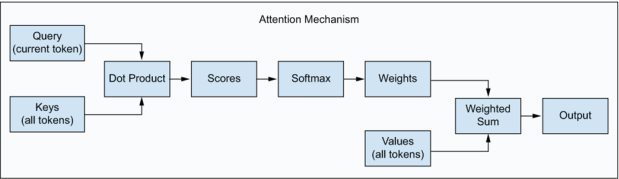

# Attention and the KV cache

> **Module thesis:** attention reads every past token's keys and values on every new token. Caching them trades quadratic recompute for memory that grows with the sequence, and that memory costs twice: in **capacity** (how many users fit) and in **traffic** (decode reads the whole cache per token). Two levers shrink it: **fewer KV heads**, fixed when the model is trained, and **fewer bits per element**, which the deployer chooses.

**Prerequisites:** [Prefill vs decode and the memory wall](Lecture9_10.md) · [Affine quantization](Lecture21_22.md) · [Quantization schemes and targets](Lecture23_24.md)

---

!!! abstract "Part 1 — Lecture 27: attention as a memory problem"
    What attention computes, why its cost is quadratic, why keys and values can be cached, and what that cache costs.

!!! question "Before we start"
    Qwen3-0.6B is 1.19 GB in BF16. How long can one conversation get before its KV cache outweighs the model?

## 1. Attention routes information by content

Every token arrives as a vector $x$ of width $d_{model}$. Three learned projections turn it into three roles:

| Vector | Role | Analogy |
| --- | --- | --- |
| **Query** $q = xW_Q$ | what this token is looking for | a search request |
| **Key** $k = xW_K$ | what this token offers to be found by | a folder's label |
| **Value** $v = xW_V$ | what this token hands over when matched | the folder's contents |

**Example:** *"The hungry dog ate the bone."*

- The query of **ate** asks, roughly, "what was eaten?"
- The key of **bone** matches that query well; the key of **hungry** matches it poorly.
- The new representation of **ate** is a **weighted blend of values**, dominated by bone's.

**The weights are computed from the data.** A convolution's weights are fixed after training; attention's mixing weights change with every sentence. This is **content-dependent routing**.

## 2. Scoring: dot product, scale, softmax

**One query against every key, then a weighted sum of every value.** The equation below is this pipeline for all queries at once.

$$
\operatorname{Attention}(Q, K, V) = \operatorname{softmax}\!\left(\frac{QK^\top}{\sqrt{d_{head}}} + M\right) V
$$

- **Score** $s_{ij} = q_i \cdot k_j$: how well token $j$'s key answers token $i$'s query.
- **Scale by $\sqrt{d_{head}}$:** a dot product of $d$ unit-variance terms has variance $d$. Unscaled, large scores saturate the softmax and one token takes all the weight.
- **Softmax** over $j$ turns scores into weights that sum to 1.
- **Mask $M$:** in a decoder, $M_{ij} = -\infty$ for $j > i$, so no token attends to the future. This **causal mask** is what makes §5.1 work.
- **Output** $o_i = \sum_j a_{ij} v_j$.

## 3. Multi-head attention

One query per token must serve every relationship at once. In *"The exhausted dog ate the bone he buried yesterday"*, **he** needs **dog**, **ate** needs **bone**, and **buried** needs **yesterday**. One query averages them into a blur.

**Multi-head attention runs $h$ attentions in parallel**, each with its own projections:

- Each head projects the **full** $d_{model}$ vector down to $d_{head}$ through its own $W_Q^{(i)}, W_K^{(i)}, W_V^{(i)}$. **It is a learned projection, not a slice**: every head sees every input dimension and keeps what it needs.
- The $h$ outputs are **concatenated** into a vector of width $h \cdot d_{head}$.
- An **output projection** $W_O$ maps it back to $d_{model}$ and mixes what the heads found.
- With $h \cdot d_{head} = d_{model}$, the FLOPs equal one wide head. The heads buy specialisation at no extra arithmetic.

**Qwen3-0.6B shows it is a projection.** $d_{model} = 1024$, but $16 \times 128 = 2048$. A slice cannot produce more numbers than it started with; a projection can.

| Tensor | Shape, Qwen3-0.6B |
| --- | --- |
| input $X$ | $n \times 1024$ |
| $W_Q$, all heads | $1024 \times (16 \cdot 128)$ |
| $W_K$, $W_V$, all heads | $1024 \times (8 \cdot 128)$: fewer KV heads, see §5.4 |
| $W_O$ | $2048 \times 1024$ |

## 4. The cost is quadratic

Every query is compared with every key, **including its own**. Direction matters too: *ate → bone* and *bone → ate* are different scores.

| Sequence | Scores per head per layer |
| ---: | ---: |
| 6 tokens | $6^2 =$ 36 |
| 4,096 tokens | $4096^2 \approx$ **16.8 million** |
| 32,768 tokens | $\approx$ **1.07 billion** |

- **Qwen3-0.6B at 4,096 tokens:** 16 heads × 28 layers × 16.8M ≈ **7.5 billion scores** per forward pass.
- **Memory:** one head's $4096 \times 4096$ score matrix is **32 MiB** in FP16. At 32K tokens it is **2 GiB**.
- The causal mask uses only the lower triangle, $n(n+1)/2$ (21 of the 36). A straightforward kernel still computes the full square and masks it.

!!! question "Double the context"
    Context goes from 4K to 8K tokens. By what factor do the scores grow? The weights?

## 5. The KV cache

Part 1 prices the cache; Part 2 shrinks it.

### 5.1 What is cached, and why it is exact

**Prefill** reads the whole prompt in one pass: the $n^2$ case, compute-bound. **Decode** then generates one token per pass ([Lecture 9/10](Lecture9_10.md) §3).

Generating token 101 needs:

- **its own query**, computed fresh;
- **the keys and values of tokens 1–100**, to score against and blend.

**Why store keys and values, but not queries?** A past token's query was used once, to compute that token's own output. Token 101's output uses only token 101's query. Old queries are never read again.

**Does a new token rewrite the keys and values of earlier ones? No.** The causal mask means token $j$'s hidden state, at every layer, depends only on tokens $\le j$. Its key and value are **fixed the moment they are computed**.

| Per decode step | Without a cache | With a cache |
| --- | --- | --- |
| K, V projections | all $t$ tokens, again | **1 new token** |
| Scores | $t$ | $t$ |
| Memory held | none | **every past K and V** |

**The trade:** recompute that grows with every step, exchanged for memory that grows with every token. §5.2 prices that memory.

### 5.2 Sizing the cache

$$
\text{KV bytes per token} = 2 \times n_{layers} \times n_{kv\_heads} \times d_{head} \times \text{bytes per element}
$$

The leading 2 counts $K$ and $V$. Every term comes from the model's `config.json`.

| Model | Layers | Q heads | KV heads | $d_{head}$ | Weights, BF16 | **KV / token** | KV at max context |
| --- | ---: | ---: | ---: | ---: | ---: | ---: | ---: |
| **Qwen3-0.6B** | 28 | 16 | 8 | 128 | 1.19 GB | **112 KiB** | 4.38 GiB at 40,960 |
| **Llama-2-7B** | 32 | 32 | 32 | 128 | 13.48 GB | **512 KiB** | 2.00 GiB at 4,096 |
| **Llama-3-8B** | 32 | 32 | 8 | 128 | 16.06 GB | **128 KiB** | 1.00 GiB at 8,192 |

- **Answer to the opener:** 1.19 GB ÷ 112 KiB ≈ **10.4K tokens**, well inside Qwen3-0.6B's 40K window.
- **Read every term from `config.json`**, $d_{head}$ included.
- Llama-2-7B's cache matches its weights at 25.7K tokens. Its window is 4,096, so that takes **about 6 users** at full context.

!!! tip "Notebook — KV cache, measured · §5.2"
    Predict one layer's K shape and the total KV bytes for 256 tokens, then run it: the formula is checked against Qwen3-0.6B's real cache, byte for byte.

    [**Open in Colab**](https://colab.research.google.com/github/Ankush-Chander/DS635-ml-system-engineering/blob/main/docs/notebooks/kv_cache_shapes.ipynb) · [view on GitHub](https://github.com/Ankush-Chander/DS635-ml-system-engineering/blob/main/docs/notebooks/kv_cache_shapes.ipynb)

### 5.3 Two costs, not one

| Cost | What grows | Consequence |
| --- | --- | --- |
| **Capacity** | bytes resident per user | users that fit $=$ KV budget $\div$ (context $\times$ bytes per token) |
| **Traffic** | bytes read per decode step | each step reads weights **plus the whole cache**, so tok/s falls as context grows |

- Measured on a 27B model, BF16 KV: **56 tok/s at 32 prompt tokens, 23 tok/s at 101K**. Same weights, same GPU.
- Weights dominate a short prompt's traffic. At long context the cache does.

### 5.4 Lever 1 — fewer KV heads

| Scheme | KV heads | KV size relative to MHA |
| --- | --- | --- |
| **MHA** | one per query head | 1× |
| **GQA** | one per group of query heads | $n_{kv} / n_{heads}$ |
| **MQA** | one for all query heads | $1 / n_{heads}$ |

- Llama-3-8B shares each KV head across 4 query heads: **128 KiB per token**, a quarter of Llama-2-7B's.
- Its cache equals its weights only at 122.5K tokens, **about 15 users** at its 8K window.
- **Hybrid models** go further: only their full-attention layers keep a KV cache.
- **The catch:** the head count is fixed at training time. For a model you are handed, the remaining knob is **bytes per element**.

---

!!! abstract "Part 2 — Lecture 28: quantizing the KV cache"
    Why the cache needs dynamic scales, why keys and values get different granularity, and when FP8 KV pays.

!!! question "Predict"
    Turn on FP8 KV for a 27B model. Is decode faster or slower at a 32-token prompt? At 101K tokens?

### 5.5 When quantizing it pays

| Prompt tokens | BF16 KV, tok/s | FP8 KV, tok/s | Change |
| ---: | ---: | ---: | ---: |
| 32 | 56.31 | 54.53 | **−3%** |
| 15,422 | 40.47 | 42.58 | +5% |
| 30,922 | 35.78 | 42.61 | +19% |
| 101,320 | 22.65 | 36.25 | **+60%** |

- Quantize and dequantize cost the same per token at any length. **The traffic saved grows with context.**
- In FP8 the curve flattens: the cache term shrinks until weight reads dominate again.

### 5.6 Neither weight nor activation

- The cache is **produced online**, like an activation, and **reread on every step**, like a weight.
- It does not exist before inference, so there is no offline calibration. **Scales are dynamic** ([Lecture 23/24](Lecture23_24.md) §1.2).

### 5.7 Keys and values differ

| Tensor | Side of the softmax | Structure | Granularity |
| --- | --- | --- | --- |
| **K** | before: decides **which** tokens match | a few **outlier channels**, the same ones on every token | **per-channel** |
| **V** | after: carries **what** flows forward | variation **between tokens** | **per-token** |

- Measured on TinyLlama-1.1B, per-channel keys beat per-token keys in **6 of 6** tests, by 1.3–3.6×. The gap widens with depth.
- This is [Lecture 21/22](Lecture21_22.md) §5's rule: match the scale's grouping to where the outliers live.
- Per-token scales for $V$ cost 2 bytes per token per head: **about 3%** on 64 bytes of INT4 data at $d_{head} = 128$.

### 5.8 The streaming catch

- A per-channel scale for $K$ is a maximum **over tokens**. During decode, those tokens arrive one at a time.
- Fix: quantize keys per channel **within groups of tokens**, and hold the newest tokens in FP16 until a group fills (KIVI).

### 5.9 FP8 KV in practice

- **E4M3** is the default: cache values are well scaled, so mantissa beats range.
- **It pays twice.** With the same 12.4 GiB pool at a 131K-token limit, concurrency rose from **1.31× to 2.36×**: one resident long session became two.
- **It is lossy.** It perturbs attention scores, so check quality at the **longest** context you serve.

### 5.10 Below 4 bits

- **TurboQuant:** a random rotation spreads outlier channels evenly, and a fixed codebook quantizes each coordinate. **No calibration**, so it suits a tensor that arrives one vector at a time.
- **Decision rule:** judge the flag against **your context distribution**. Leave it off for chat under ~2K tokens; turn it on for agents working at 15K+.

## 6. FlashAttention: compute it in tiles

**The KV cache removes recompute from decode. Prefill still builds §4's score matrix, 32 MiB per head at 4,096 tokens, and shared memory is far too small to hold it, so the matrix is never formed whole.**

- Load a **tile** of queries and a tile of keys and values into shared memory ([Lecture 8](Lecture8.md) §7).
- Compute that tile's scores and fold them into the output with a **running softmax**: keep the row's maximum and sum so far, and rescale as new tiles arrive.
- Discard the tile and load the next one. **The $n \times n$ matrix never reaches HBM.**
- **The result is exact.** The arithmetic is reordered; nothing is approximated.
- **It changes traffic, not FLOPs or storage.** The work is still $O(n^2)$, and the KV cache is the same size.

!!! tip "Further exploration"
    Dao et al., *FlashAttention* (2022): the online-softmax rescaling that lets a tile be normalised before its row is complete.

---

## References

1. Vivek Kalyanarangan, *Quantization and Fast Inference*, Manning Publications — §3.4 key/value asymmetry and scale overhead; §7.5 TurboQuant; §10.5.1 the KV formula and GQA
2. Dao et al., [*FlashAttention: Fast and Memory-Efficient Exact Attention with IO-Awareness*](https://arxiv.org/abs/2205.14135) (2022)
3. Ainslie et al., [*GQA: Training Generalized Multi-Query Transformer Models from Multi-Head Checkpoints*](https://arxiv.org/abs/2305.13245) (2023)
4. Liu et al., [*KIVI: A Tuning-Free Asymmetric 2bit Quantization for KV Cache*](https://arxiv.org/abs/2402.02750) (2024)
5. Hooper et al., [*KVQuant: Towards 10 Million Context Length LLM Inference with KV Cache Quantization*](https://arxiv.org/abs/2401.18079) (2024)
6. Model configs: [Qwen3-0.6B](https://huggingface.co/Qwen/Qwen3-0.6B/blob/main/config.json) · [Llama-2-7B](https://huggingface.co/NousResearch/Llama-2-7b-hf/blob/main/config.json) · [Llama-3-8B](https://huggingface.co/NousResearch/Meta-Llama-3-8B/blob/main/config.json)
7. [Lecture 9/10](Lecture9_10.md) — prefill vs decode on the roofline
8. [Lecture 23/24](Lecture23_24.md) — static vs dynamic scales
