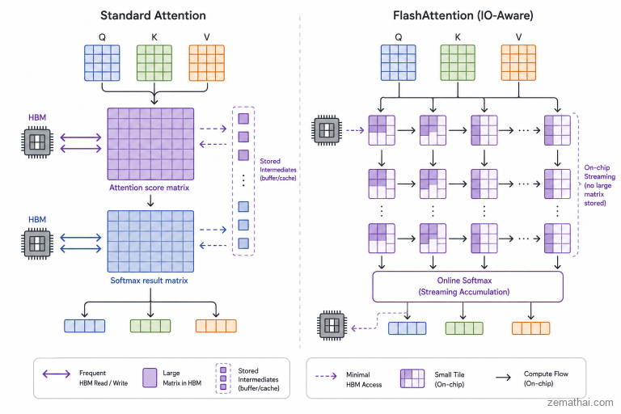

# Serving: FlashAttention, continuous batching and PagedAttention

> **Module thesis:** [Lecture 27/28](Lecture27_28.md) sized the KV cache per user. A server holds many users at once, so its real capacity is the **KV pool**, and three mechanisms decide how much of that pool does useful work: the **kernel** that computes attention without spilling the score matrix to memory, the **scheduler** that chooses who runs each step, and the **allocator** that places each sequence's cache in memory.

**Prerequisites:** [Prefill vs decode and the memory wall](Lecture9_10.md) · [Attention and the KV cache](Lecture27_28.md)

---

!!! question "Before we start"
    An A6000 (48 GB) serves Llama-3-8B in BF16. About 25 GiB is left for the KV cache: **≈ 200K tokens, or ≈ 25 users at the full 8K window**. Why does a naive server fit far fewer?

## 1. FlashAttention: never store the score matrix

**Attention is limited by memory traffic, not FLOPs.** A standard kernel writes the $n \times n$ score matrix to HBM, reads it back for softmax, writes the probabilities, then reads them again to weight $V$. FlashAttention computes the same result **tile by tile in on-chip SRAM** and never stores the matrix.

*Figure: ZeroMathAI, [FlashAttention IO-Awareness](https://zeromathai.com/en/flashattention-io-awareness-en/).*

| Memory on an A100 | Size | Bandwidth |
| --- | --- | ---: |
| **HBM** | 40–80 GB | 1.5–2.0 TB/s |
| **SRAM** | 192 KB per SM × 108 SMs ≈ 20 MB | ≈ 19 TB/s |

- **The matrix is the traffic.** [Lecture 27/28](Lecture27_28.md) §4: one head's 4,096 × 4,096 score matrix is **32 MiB** in FP16, **2 GiB** at 32K tokens. A standard kernel moves it through HBM several times, per head, per layer.
- **SRAM is 10× faster but 1,000× smaller.** The matrix cannot fit there, so the work has to come in tiles.

### 1.1 Tiling

**$z$ is attention's output:** for each query, the weighted average of the value vectors, $z = \sum_j p_j v_j$. It is the only result the next layer needs. (The FlashAttention paper writes it $O$.)

1. Load a block of $Q$ rows and a block of $K$, $V$ rows into SRAM.
2. Compute that tile's scores, its softmax contribution and its weighted values, all on chip.
3. Move to the next $K$, $V$ block. Only the output $z$ goes back to HBM.

- **Extra memory falls from quadratic to linear in $n$:** no score matrix is ever materialised.
- **FLOPs do not fall.** Training's backward pass recomputes the scores instead of storing them, so it does slightly *more* arithmetic, and still runs faster.

### 1.2 Online softmax

**The probabilities are never needed, only their weighted sum of values.** Attention's output is $z = \sum_j p_j v_j$, and the denominator of every $p_j$ is the same row sum. So divide **once, at the end**:

$$
z = \sum_j \frac{e^{s_j}}{\ell}\, v_j = \frac{1}{\ell} \underbrace{\sum_j e^{s_j}\, v_j}_{\tilde z}
$$

FlashAttention keeps **three running quantities** per query row, and updates them block by block:

| Quantity | Meaning | Update when a block raises the max from $m$ to $m_{new}$ |
| --- | --- | --- |
| $m$ | largest score so far | $m_{new} = \max(m,\ \max_j s_j)$ |
| $\ell$ | sum of $e^{s_j - m}$ so far | $\ell \, e^{m - m_{new}} + \sum_j e^{s_j - m_{new}}$ |
| $\tilde z$ | **unnormalised output:** sum of $e^{s_j - m}\, v_j$ so far | $\tilde z \, e^{m - m_{new}} + \sum_j e^{s_j - m_{new}}\, v_j$ |

- **Why rescaling works:** every old term was computed as $e^{s - m}$. Multiplying by $e^{m - m_{new}}$ turns it into $e^{s - m_{new}}$, exactly what it would have been had the new max been known from the start.
- **After the last block:** $z = \tilde z / \ell$. Each $p_j$ existed only inside its tile, for one multiply-add, and was then discarded.
- **Subtracting the max prevents overflow:** $e^{s - m} \le 1$, always.
- **Training's backward pass** needs the $p_j$ again, so it keeps only $m$ and $\ell$ per row and **recomputes** $p_j = e^{s_j - m} / \ell$ tile by tile (§1.1).

??? example "Worked example: scores [2, 1, 3, 5], values [10, 20, 30, 40], read in two blocks"

    | Step | Block | $m$ | $\ell$ | $\tilde z$ |
    | --- | --- | ---: | ---: | ---: |
    | 1 | scores $[2, 1]$, values $[10, 20]$ | 2 | $e^{0} + e^{-1} = 1.368$ | $e^{0}\cdot 10 + e^{-1}\cdot 20 = 17.358$ |
    | 2 | scores $[3, 5]$, values $[30, 40]$ | 5 | $1.368\, e^{-3} + e^{-2} + e^{0} = 1.203$ | $17.358\, e^{-3} + e^{-2}\cdot 30 + e^{0}\cdot 40 = 44.924$ |

    **Output:** $z = 44.924 / 1.203 = \mathbf{37.33}$.

    **Check, standard softmax on all four scores at once:**

    $$
    p_j = \frac{e^{s_j}}{\sum_{k} e^{s_k}}, \qquad
    \sum_k e^{s_k} = e^{2} + e^{1} + e^{3} + e^{5} = 7.39 + 2.72 + 20.09 + 148.41 = 178.61
    $$

    $$
    p = \left[\tfrac{7.39}{178.61},\ \tfrac{2.72}{178.61},\ \tfrac{20.09}{178.61},\ \tfrac{148.41}{178.61}\right] = [0.041,\ 0.015,\ 0.112,\ 0.831]
    $$

    $$
    z = \sum_j p_j v_j = 0.041\cdot10 + 0.015\cdot20 + 0.112\cdot30 + 0.831\cdot40 = \mathbf{37.33}
    $$

    Same output; no full row of $p$ was ever stored. The streaming $\ell = 1.203$ is this sum measured from the max: $178.61 / e^{5} \approx 1.203$.

    Values here are 1-D for readability; with $d_h$-wide values, $\tilde z$ and $z$ are vectors and every coordinate follows the same steps with the same weights.

### 1.3 What it buys, and where

| Pros | Cons |
| --- | --- |
| **Exact:** the same output as standard attention, not an approximation | **Hard to write:** a hand-tuned kernel per GPU generation (FlashAttention-2 for Ampere, -3 for Hopper) |
| **Faster:** about 3× on GPT-2 training at 1K tokens in the original paper; 2–4× is typical, depending on GPU and length | **Gains vary** with hardware and sequence length |
| **Long context fits:** attention memory grows linearly in $n$ | |

- **The win is largest in prefill and training**, where $n$ queries meet $n$ keys.
- **Decode has one query row,** so its score row is tiny. Its cost is reading the KV cache ([Lecture 27/28](Lecture27_28.md) §5.3), which is the problem the rest of this lecture manages.

## 2. Static batching wastes the GPU

- A static batch runs until its **longest** sequence finishes.
- Sequences that finish early leave idle slots; new requests wait for the whole batch.
- **Dynamic batching** starts a batch when it is **full or a timeout expires**, whichever comes first. Requests wait less, but each batch still runs to its longest sequence.
- [Lecture 9/10](Lecture9_10.md) §1: online serving cannot wait for a full batch, so idle slots cost directly in occupancy.

## 3. Continuous batching

- Schedule **per decode step**, not per request: sequences join and leave the batch every iteration (Orca).
- One step can mix a new request's **prefill** with other requests' **decode**.
- **Chunked prefill** splits a long prompt across steps, so one large prompt does not stall every user's next token.

## References

1. Yu et al., [*Orca: A Distributed Serving System for Transformer-Based Generative Models*](https://www.usenix.org/conference/osdi22/presentation/yu) (OSDI 2022) — iteration-level scheduling
2. Kwon et al., [*Efficient Memory Management for Large Language Model Serving with PagedAttention*](https://arxiv.org/abs/2309.06180) (SOSP 2023) — block tables, KV utilisation of earlier systems, copy-on-write sharing, preemption
3. Agrawal et al., [*Taming Throughput-Latency Tradeoff in LLM Inference with Sarathi-Serve*](https://arxiv.org/abs/2403.02310) (OSDI 2024) — chunked prefill
4. Vivek Kalyanarangan, *Quantization and Fast Inference*, Manning Publications — §12.1 serving a four-bit model through vLLM
5. [Lecture 9/10](Lecture9_10.md) — batch vs online workloads
6. [Lecture 27/28](Lecture27_28.md) — sizing the KV cache
7. Dao et al., [*FlashAttention: Fast and Memory-Efficient Exact Attention with IO-Awareness*](https://arxiv.org/abs/2205.14135) (NeurIPS 2022) — tiling, online softmax, recomputation, A100 HBM/SRAM figures
8. ZeroMathAI, [*FlashAttention IO-Awareness*](https://zeromathai.com/en/flashattention-io-awareness-en/) (2026) — IO bottleneck, streaming softmax, figure
